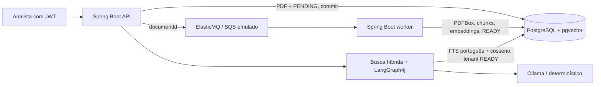

# JurisRAG

Assistente de pesquisa para analistas jurídicos consultarem prazos e obrigações em contratos sintéticos de uma empresa fictícia de energia. As respostas apontam documento, página física e trecho literal; o fluxo faz no máximo duas buscas e se abstém quando a evidência continua fraca.

## Rodar a demonstração local

Pré-requisitos: Docker Compose, Python 3 e OpenSSL. Para compilar e executar os testes: JDK 21 e Docker acessível ao Testcontainers. Nenhuma conta AWS é necessária.

```bash
cd juris-rag
./scripts/dev-setup.sh
docker compose up -d --build
docker compose ps
python3 scripts/demo.py
```

O setup cria PDFs sintéticos com páginas conhecidas e uma chave JWT RS256 descartável para cada tenant. A API e o worker usam a mesma imagem e o mesmo banco; apenas a API publica a porta HTTP. O perfil padrão `deterministic` torna embeddings e decisões reproduzíveis sem baixar modelos. O resultado da demonstração é gravado em `portfolio-publico/resultados/ultima-execucao.json` com as três perguntas rotuladas, citações, latência observada pelo cliente e métricas Micrometer. O relatório contém somente dados sintéticos.

O token de demonstração expira em 24 horas. Execute `./scripts/dev-setup.sh` novamente para gerar chaves novas; depois recrie os serviços para que a API carregue a nova chave pública:

```bash
docker compose up -d --force-recreate api worker
```

### Usar Ollama

Edite `.env` e defina `AI_PROFILE=ollama`. Então inicie o serviço opcional e baixe os modelos:

```bash
docker compose --profile ollama up -d --build
docker compose exec ollama ollama pull qwen2.5:3b
docker compose exec ollama ollama pull nomic-embed-text
```

O chat e os embeddings usam os nomes e a URL definidos por `OLLAMA_CHAT_MODEL`, `OLLAMA_EMBEDDING_MODEL` e `OLLAMA_BASE_URL`. `nomic-embed-text` deve produzir 768 dimensões para coincidir com a migração do pgvector. O relatório usa `attempts` devolvido pelo agente para registrar as buscas realmente observadas, inclusive no modo Ollama. As respostas do modelo podem variar; o script valida os resultados e falha com a etapa que não passou.

### Validar a API com curl

```bash
JURIS_TOKEN="$(cat .local/token-energia-demo.txt)"

curl -i -X POST http://localhost:8080/v1/documents \
  -H "Authorization: Bearer ${JURIS_TOKEN}" \
  -F 'title=Contrato 001 — Fornecimento' \
  -F 'file=@fixtures/demo/contrato-001.pdf;type=application/pdf'

curl -s http://localhost:8080/v1/queries \
  -H "Authorization: Bearer ${JURIS_TOKEN}" \
  -H 'Content-Type: application/json' \
  -d '{"question":"Qual o prazo de pagamento da fatura do Contrato 001?"}'
```

O upload responde `202 Accepted`, com `documentId` e `statusUrl`. Consulte o estado pelo `GET /v1/documents/{documentId}` até chegar a `READY`. O script `scripts/demo.py` já automatiza upload, espera com timeout, consulta e verificação das páginas e citações.

### Três cenários rotulados

| Caso | Pergunta | Verificação da demo |
| --- | --- | --- |
| Resposta direta | Qual o prazo de pagamento da fatura do Contrato 001? | 30 dias corridos após recebimento; Contrato 001, página 1. |
| Reformulação | Com quanta antecedência precisamos avisar para encerrar o Contrato 001 sem motivo? | Segunda busca usa termos jurídicos; prazo atual de 60 dias, anterior de 90; contrato, página 2, e aditivo, página 1. |
| Abstenção | Qual a multa por vazamento de dados no Contrato 001? | `INSUFFICIENT_EVIDENCE`, sem citações inventadas. |

Há também uma checagem adicional com o token do segundo tenant: a pergunta de pagamento deve citar somente o documento desse tenant e mostrar seus 7 dias úteis. O token do primeiro tenant recebe 404 ao consultar o ID do segundo.

## Arquitetura



O projeto é um módulo Maven com Java 21 e Spring Boot. Perfis Spring independentes iniciam `api` e `worker` usando o mesmo artefato e imagem. O banco guarda PDFs pequenos em `BYTEA`, estado de ingestão e trechos. PDFBox extrai por página; o particionador tenta preservar cláusulas. A busca combina até dez resultados lexicais em português e dez vetoriais por cosseno; o RRF em Java limita o contexto a cinco trechos. A varredura vetorial é exata para o acervo pequeno.

LangChain4j conecta embeddings e chat ao Ollama. LangGraph4j mantém pergunta original/atual, tentativa, lacuna, evidências aprovadas e IDs de citação. Depois de uma avaliação insuficiente, o grafo reformula uma vez e busca de novo. O backend valida a procedência de cada ID e monta as citações com metadados do banco. A política de aditivos verifica o contrato, a cláusula e a vigência relativa à data fixa em `REFERENCE_DATE`; uma alteração exige citação do contrato e do aditivo.

`tenant_id` vem exclusivamente do JWT. A assinatura RS256, emissor, audiência e validade temporal são conferidos antes dos endpoints; buscas lexicais e vetoriais filtram tenant e documento `READY`. Logs não incluem PDFs, trechos, prompts, tokens ou chaves.

## Recuperação de falhas

O upload confirma no PostgreSQL antes de publicar o ID no SQS. Se o envio falhar, a API retorna 503 e mantém o documento `PENDING`. O cliente pode reenviar o mesmo PDF no mesmo tenant: o hash reutiliza o ID e o serviço tenta publicar novamente. Isso cobre a janela entre commit e envio sem adicionar um outbox à demo. O worker trava a linha do documento, grava trechos e `READY` numa transação e só depois exclui a mensagem. Reentregas concorrentes não repetem os trechos. Falhas transitórias continuam na fila; após cinco entregas, ElasticMQ encaminha a mensagem à DLQ.

Para reencaminhar manualmente um documento `PENDING` após uma falha persistente, envie seu ID à fila de ingestão (AWS CLI instalado localmente):

```bash
aws --endpoint-url http://localhost:9324 --region us-east-1 sqs send-message \
  --queue-url http://localhost:9324/000000000000/juris-rag-ingestion \
  --message-body '{"documentId":"UUID_DO_DOCUMENTO"}'
```

Para uma mensagem na DLQ, copie o `documentId` para a fila principal e remova a mensagem da DLQ após confirmar o reenvio. PDFs inválidos ou sem camada de texto terminam como `FAILED`; falha técnica de banco/modelo/fila é separada da abstenção do agente e aparece como erro HTTP.

## Testes, métricas e CI

```bash
./mvnw --batch-mode verify
docker compose up -d --build
python3 scripts/demo.py
```

JUnit cobre extração por cláusula/página, política de vigência, resposta direta, reformulação, abstenção e rejeição de citações inventadas. Testcontainers executa a migração e testa a publicação idempotente com duas entregas concorrentes e o isolamento tenant na busca lexical e vetorial usando a imagem PostgreSQL/pgvector. A integração com a fila e PDFs acontece pela demonstração no Compose. GitHub Actions roda `verify` e constrói a imagem, sem fazer push.

Micrometer publica `/actuator/health`, `/actuator/prometheus` e métricas autenticadas em `/actuator/metrics/**`. São medidos tempo de busca, tempo de geração, ingestão, tentativas, reformulações, abstenções e tokens quando o provedor informa. O script avalia uma amostra de três perguntas rotuladas e grava também as tentativas observadas por consulta.

Validação: consulte as evidências de validação em portfolio-publico/evidencias/validacao.md. Nenhuma resposta ou latência deve ser apresentada como medida sem uma execução real. Após rodar a demonstração, o relatório JSON fica em portfolio-publico/resultados/ultima-execucao.json.

## Arquitetura-alvo AWS

Esta entrega executa localmente e não provisiona AWS. O SDK Java v2 fala a API SQS do ElasticMQ. Evolução documentada: **ElasticMQ → Amazon SQS**, **PostgreSQL com pgvector → RDS for PostgreSQL**, **contêineres → ECS/Fargate**. Ollama pode ser substituído por **Amazon Bedrock**; isso é uma opção futura, não uma integração ativada aqui. S3, OpenSearch, Kubernetes, infraestrutura AWS e CD ficam fora do escopo desta versão.

## Segurança e arquivos

`.env` e `.local/` são descartáveis e ignorados pelo Git e pelo contexto Docker. As credenciais padrão do Postgres, JWTs e chaves servem somente para a demo local. Não as reutilize em ambientes compartilhados. Os PDFs são fabricados por `scripts/generate_fixtures.py`; não use contratos reais.

Este repositório contém a implementação, exemplos sintéticos e materiais de apresentação. Consulte o contrato OpenAPI e as evidências de validação em portfolio-publico/.