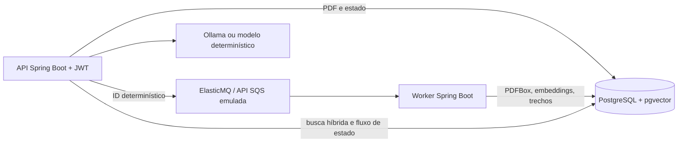

# JurisRAG — assistente jurídico com evidências

## Objetivo

Protótipo local para analistas jurídicos consultarem obrigações e prazos em contratos sintéticos de uma empresa fictícia de energia. Cada resposta deve apontar o documento, a página física e o trecho que a sustenta. O fluxo oferece uma reformulação e se abstém quando a evidência é insuficiente.

## Visão da arquitetura

- Java 21, Spring Boot, Maven Wrapper, API REST e worker em contêineres separados.
- PDFBox, LangChain4j e LangGraph4j para ingestão e consulta agêntica.
- Spring JDBC, Flyway, PostgreSQL com pgvector, busca textual em português e fusão RRF.
- AWS SDK Java v2 para a API SQS local do ElasticMQ.
- JWT RS256 com tenant extraído exclusivamente do token; métricas com Actuator/Micrometer.
- S3, OpenSearch, Kubernetes e provisionamento AWS estão fora desta versão.

## Exemplos sintéticos

| Consulta | Comportamento esperado |
| --- | --- |
| Qual o prazo de pagamento da fatura do Contrato 001? | 30 dias corridos após o recebimento, citando Contrato 001, página 1. |
| Com quanta antecedência precisamos avisar para encerrar o Contrato 001 sem motivo? | Reformula para termos jurídicos; cita a cláusula original de 90 dias e o aditivo vigente de 60 dias. |
| Qual a multa por vazamento de dados no Contrato 001? | Abstenção sem citação inventada. |

O segundo tenant possui um contrato sintético semelhante, com 7 dias úteis para pagamento. A checagem de isolamento confirma que esse documento não aparece para o primeiro tenant.

## Verificação

A implementação contém testes JUnit para o fluxo direto, reformulação, abstenção, IDs de citação inválidos, política de vigência e particionamento de páginas. Um teste Testcontainers cobre PostgreSQL/pgvector, reentrega concorrente idempotente e filtros tenant na busca lexical e vetorial. `scripts/demo.py` exercita o worker na fila ElasticMQ via Compose e valida três perguntas rotuladas mais isolamento entre tenants.

Medições pendentes: este repositório ainda não inclui um relatório de execução ponta a ponta. Os testes Java/Testcontainers, a integração ElasticMQ/Ollama e as três consultas devem ser executados antes de publicar métricas ou resultados como verificados. A pasta resultados explica como gerar o relatório.

## Alvo de evolução

ElasticMQ → Amazon SQS; PostgreSQL/pgvector → RDS for PostgreSQL; contêineres → ECS/Fargate. Bedrock pode substituir Ollama numa evolução futura. A versão atual é local e usa SQS emulado.

Consulte o contrato OpenAPI e as evidências de validação.